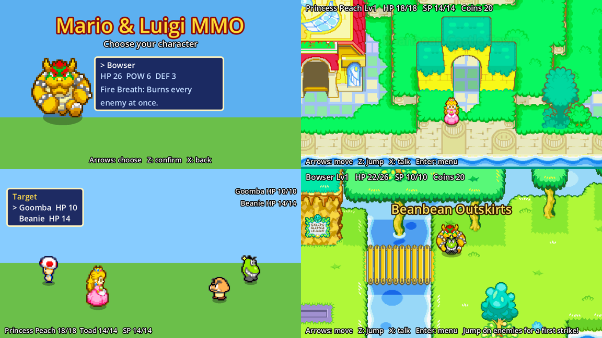

# Mario & Luigi MMO (Godot 4)

A Superstar Saga style RPG that runs in the browser. Play the latest build at
https://rileymusil.github.io/mario-luigi-mmorpg/ (every push to `main` redeploys).

## Open it
1. Install Godot 4.4 or newer (standard version, not .NET).
2. In the Project Manager choose **Import**, pick this folder's `project.godot`, then press **F5** to play.

## Controls
| Action | Keyboard | Gamepad | Touch screen |
|---|---|---|---|
| Move | Arrows / WASD | D-pad | Joystick (bottom left) |
| Jump, confirm, timed presses | Z, J or Space | A | Red **A** button |
| Talk, ask, back | X or K | B | Green **B** button |
| Menu | Enter or Esc | Start | **MENU** (top right) |
| Chat | T or / | | **Chat** button (bottom right) |

**Mouse and touch.** Every menu works with the mouse: point at an option to move the pointer, click it to pick it, right-click or click outside the menu to go back (where the menu has a way back). On a touch screen, tap an option to pick it (slide your finger off before lifting to change your mind) and tap outside the menu to go back. Click or tap anywhere to read on when someone is talking. Click or tap someone with a "!" over their head to talk to them, and click a partner's card in the party screen to pick them. Text boxes (username, chat) have OK and Back buttons.

**Phones and tablets.** Hold the phone sideways. The on-screen controls show on touch screens (or after your first touch) and hide when you press a key; several fingers work at once, so you can walk and jump together. Only the buttons that make sense show: none on the title screen (tap the menus), A and B in battle, all of them while walking around, and none while someone is talking. On Android, the corners button next to MENU goes full screen and keeps the game sideways; on iPhone, use Share > Add to Home Screen to play full screen. Typing (your username, or chat with the Chat button) opens the browser's own text box, so the phone's keyboard comes up.

## What you can do
- **Pick a side and a character.** Good: Mario, Luigi, Princess Peach, Waluigi, Rosalina, Toadette. Evil: Bowser, Bowser Jr., Shadow Mario.
  Good players start in Beanbean Castle Town, evil players at Bowser's Castle.
- **Explore three maps** built from the Superstar Saga map art: Castle Town, Beanbean Outskirts and Bowser's Castle, joined by exits at the town gates, the Outskirts' south path and east bridge, and the castle's rail bridge.
- **Battle** enemies in the Outskirts (Goombas, Galoombas, Beanies, Koopa Troopas, Shy Guys, Buzzy Beetles and Dry Bones). Touch one to fight; jump on it first for a first strike.
  - *Jump*: press Z as you land for a second stomp (Good / Excellent).
  - *Special* (costs SP): Mario's Fire Jump burns, Luigi's Thunderhand can stun, Peach's Heart heals the party, Bowser's Fire Breath hits every enemy, Waluigi's Wicked Whirl hits every enemy and can stun them, Rosalina's Star Spin hits and heals, Toadette's Pickaxe Pound ignores defense, Bowser Jr.'s Goop Paint can stun, Shadow Mario's Shadow Drain steals HP. Press Z in the gold zone.
  - *Enemy turns*: press Z so whoever is attacked is in the air when it hits.
- **Recruit.** Good players ask Toad or the Pianta in Castle Town (X to talk). Evil players use *Ask to join* in battle; hurt enemies say yes more often. Up to 2 follow you and fight on their own turn.
- **Grow.** XP and levels (cap 50), coins, Mushrooms. Losing sends you home with a few coins lost.
- **Switch sides** any time from the menu. **Saves** go to the browser automatically.

## Project layout
- `scenes/title.tscn` (main scene), `scenes/world.tscn` (any map), `scenes/battle.tscn`.
- `scripts/game.gd` (autoload `Game`): all data tables (characters, specials, partners, enemies, maps with exits, spawns, enemies and NPCs), the save, and scene changes. Most tuning happens here.
- `scripts/world.gd`: map loading, walking on the walk mask, followers, enemies, talking, pause menu.
- `scripts/map_props.gd`: trees, buildings and other tall things you can walk behind (props), the walk mask loader. `scripts/map_editor.gd`: the debug-only map editor (F2).
- `scripts/battle.gd`: battle flow, timed presses, specials, recruiting, XP.
- `scripts/character_sprite.gd`, `scripts/choice_menu.gd`: shared sprite and menu box (keys, mouse and touch).
- `ui/touch_controls.gd` (autoload `TouchControls`): the on-screen joystick (`ui/touch_stick.gd`) and buttons (`ui/touch_button.gd`). They press the same input actions as the keys, so game code just reads `Input` as usual. Anything that should hide them while it is open joins the `touch_blockers` group (the speech balloon and text box do). `ui/pointer.gd` has small helpers that treat a click and a tap alike.
- `ui/theme.tres`: the project's default theme (Superstar Saga font, speech-balloon panels and the
  `NavyPanel`, `StripPanel`, `NotebookPanel`, `RedCard`/`GreenCard`, `FlatPanel` and
  `LightLabel`, `InfoLabel`, `TitleLabel`, `OutlineLabel`, `GoldLabel` variations).
  `ui/` also holds the reusable pieces: `dialogue_box` (typed-in speech balloon), `hud`,
  `area_banner`, `pause_screen` (notebook), `party_screen` (stat cards) and `gold_number`.
- `assets/ui/`: menu art and the bitmap fonts (`mlss_font.fnt`, `mlss_font_outline.fnt`).
- `assets/characters/`: walk sheets, 3 rows (down, right, up). `assets/maps/`: map art, `<map>_mask.png` (the ground: white = walkable) and `<map>_props.json` (trees and buildings, see below).

## Maps: ground, props and the map editor
Each map is one picture plus two data files:
- **`<map>_mask.png`** says where the *ground* is walkable (white) or blocked (black): water, lava, cliffs, ledges, walls and the map edge. It does not block trees or buildings.
- **`<map>_props.json`** lists the tall things: trees, houses, shops, lamp posts, statues, pillars. Each prop is a rectangle of the map picture, a **base line** (the y where its trunk or wall meets the ground) and an optional **footprint** (a small rectangle that blocks walking: a trunk, the front wall of a house). The game redraws each prop over the characters, sorted at its base line, so anyone whose feet are above the base line is behind it. The prop fades to half see-through while it hides the player, like in Superstar Saga. `shape` is `rect` for buildings and posts or `tree` for a rounded canopy with a trunk.
- Everyone (player, followers, enemies) collides with a 10px-wide box at their feet; other online players are shown on the nearest walkable ground.

### Map editor (debug builds only)
Run the game from the Godot editor (F5), walk to a map and press **F2**. Players never see it: the published web game is a release build. (A release build started with `-- --map-editor` also has it.)
- The mask shows tinted red where the ground is blocked. Props show as green boxes, the base line in pink and the footprint in orange.
- **1** paints walkable ground, **2** paints blocked ground (left mouse; right mouse paints the opposite). **[** and **]** change the brush size.
- **3** edits props: click a prop to select it and drag to move it (base line and footprint move with it). Drag the yellow corner squares to resize, the pink line to move just the base line, the orange box to move the footprint (its corner square resizes it). **N** adds a tree at the mouse, **C** copies the selected prop, **Delete** removes it, **T** switches tree/rectangle shape, **F** adds or removes the footprint.
- Arrow keys or WASD pan, the mouse wheel zooms. **Ctrl+S** saves `<map>_mask.png` and `<map>_props.json` straight into `assets/maps/` (in an exported debug build they go to `user://maps/` instead and are used from there). **F2** closes the editor; the game uses your edits right away.
- After saving, commit the two files. `tools/make_maps.py` rebuilds masks from scratch and would overwrite hand edits, so only re-run it for a new map.

## Adding art
The tools read the original sheets from the `Mario&LuigiMMO` art folder (not in this repo):
- `python3 tools/slice_sprites.py "<Mario&LuigiMMO folder>" [ids]` cuts walk cycles. Add a character with the pixel boxes of its down, side and up rows (options for white backgrounds and drawn-on shadows are described at the top of the script), then add it to `CHARACTERS`, `PARTNERS` or `ENEMIES` in `game.gd`.
- `python3 tools/slice_ui.py "<Mario&LuigiMMO folder>"` cuts the menu art (speech balloons, notebook, stat cards, gold digits, icons, title art, the touch A / B buttons and joystick) into `assets/ui/` and builds the two bitmap fonts from the MLSS alphabet. Re-run `godot --headless --import` afterwards.
- `python3 tools/make_maps.py "<Mario&LuigiMMO folder>" [ids]` crops a map and guesses its walk mask from colours, opening up the ground behind the props in `<map>_props.json` (`python3 tools/make_maps.py --mask-only [ids]` rebuilds just the masks from the art in the repo). Touch up masks and props in the map editor (or `_mask.png` in any paint program: white = walk, black = blocked); re-running the tool overwrites hand-painted masks.

## Publishing
`export_presets.cfg` has a **Web** preset with thread support off, so the build runs on plain static hosting like GitHub Pages. Its head include stops pinch zoom and page scrolling on phones, asks to turn portrait phones sideways, and turns the game sideways when it goes full screen on Android. The game keeps its 384x216 picture and scales it to fit (black bars at the sides on extra-wide phones), because the menus and battles are laid out for that size. `.github/workflows/deploy-pages.yml` (repo root) exports and publishes it on every push to `main`.

## Screenshot

